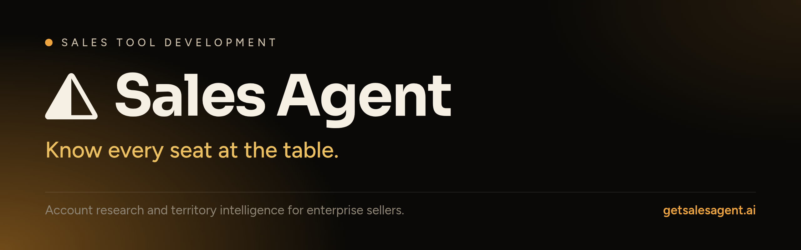

  

# Sales Agent for Mac

Signed and notarized releases of Sales Agent for Mac, for Apple Silicon Macs on macOS 14 or later.

1. Download the `.dmg` from the [latest release](https://github.com/getsalesagent/sales-agent-releases/releases/latest).
2. Open it and drag Sales Agent to Applications.
3. Enter your license key when the app first opens.

The app checks this repository for updates and installs them when you restart it.

## Built to stay on your work computer

Sales Agent runs entirely on your Mac. The accounts, contacts, notes and conversations you keep in it are stored on your computer and nowhere else. There is no Sales Agent server and no Sales Agent account, and nothing you keep in the app is ever sent back to Sales Agent.

The Agent uses the AI your company already provides: the enterprise AI account signed in on your Mac, such as your company's Claude, Amazon Bedrock, Google Vertex AI or Microsoft Foundry. Your requests go from your Mac to that provider under your company's own agreement with it, and to no one else. Apart from that, it only reaches public services, such as web pages when you ask it to research an account, map tiles, and this page for updates.

This is how Sales Agent aims to stay within your company's policies: your data stays on your computer, and the AI it uses is the one your company has already approved.

**Before you install,** please check with your people leader to make sure they are comfortable with you using this productivity tool, and follow any review your company asks for with IT or security. The full [privacy policy](https://getsalesagent.ai/privacy) lists everything the app sends and where.

This repository holds release files only. Questions: [support@getsalesagent.ai](mailto:support@getsalesagent.ai).

Sales Agent is developed and owned by Derek Trimm. See [LICENSE](LICENSE).
